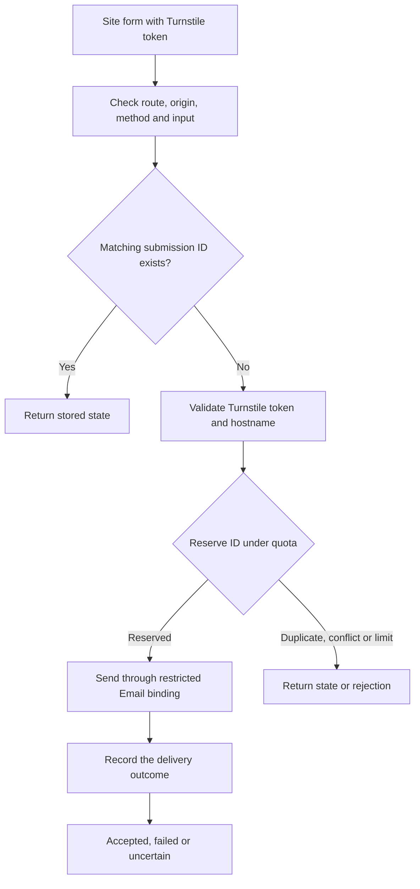

# Contact Worker architecture

The VitePress and Stackweaver sites host their own forms. Each posts to
`/api/contact` on its own origin. Each target runs the same source with its
own Worker configuration, Turnstile widget and SQLite Durable Object namespace.

## Request and email

The Worker looks up the submission ID and payload hash before validating a
fresh token. An existing ID with a different payload returns HTTP 409. For
new submissions, the Durable Object enforces per-client and per-target
limits and records the reservation before the provider call. It stores
timestamps, state and keyed hashes, and removes expired records after 24 hours.

The configured sender and verified destination are fixed. The visitor's
address becomes Reply-To. Use the exact verified destination in both target
bindings and the send payload. The bundle smoke test checks that they match.

| Response | Meaning |
| --- | --- |
| `200 accepted` | The provider returned a message ID and the Worker recorded acceptance. Check the inbox to establish delivery. |
| `202 pending` | A matching request has already reserved this ID and has yet to record an outcome. |
| `202 uncertain` | The Worker could not establish or persist the outcome. Preserve the same ID when checking again so the request cannot cause a second send during retention. |
| `503 unavailable` | Delivery failed explicitly or the Worker could not serve the request. The caller should show the email fallback. |

## Code map

| Concern | Source |
| --- | --- |
| Routing and request limits | [Worker entry point](../src/index.ts), [request parser](../src/request.ts) |
| Turnstile validation | [Challenge](../src/challenge.ts) |
| Quota, deduplication and retention | [Submission store](../src/submissions.ts) |
| Provider send and outcome mapping | [Email delivery](../src/delivery.ts) |
| Separate target bindings and routes | [VitePress](../vitepress.wrangler.json), [Stackweaver](../stackweaver.wrangler.json) |
| Exact bundle verification | [Smoke test](../scripts/bundle-smoke.mjs), [delivery workflow](../.github/workflows/delivery.yml) |

One GitHub release carries both target bundles. Activation uses an exact tag
and a single protected environment. The deployment receipt records the active
and previous Worker versions. A rollback targets one Worker and leaves its
Durable Object state in place. [Staging and rollback runbook](staging.md)
