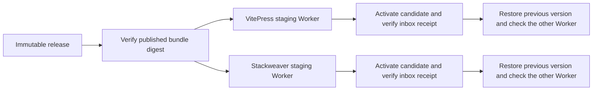

# Rehearse contact delivery on Cloudflare

The GitHub `rehearse` operation verifies the published artifact and target
secret wiring with a Wrangler dry run. A Cloudflare staging test exercises
real version activation, rollback and delivery using isolated Workers.

## Prepare isolated targets

Use separate staging Worker names and hostnames for VitePress and Stackweaver.
Give each its own Durable Object namespace, HMAC secret and host-scoped
Turnstile widget. Bind delivery only to the approved inbox using an existing
verified sender. Match the exact spelling of the inbox in Cloudflare's
verified destination list. Keep public production routes and mail DNS out of
staging.

The manifests in `v0.1.0` bind the bundles to the production Worker names
and configurations. The deployment action will reject a staging configuration
with those manifests. A provider-only test can verify the same module bytes
with separately recorded staging configuration. Testing the GitHub activation
path on staging needs release manifests for those staging targets.

## Verify one target at a time

1. Record the release tag, published SHA-256 and staging configuration digest.
   Provision the isolated Worker and its SQLite Durable Object if needed. Record
   the active baseline version and the other staging target's deployment ID.
2. Upload the candidate from the verified module using Wrangler's
   `versions upload --no-bundle` path. Activate the returned version at 100%
   and confirm the active version through Cloudflare.
3. Submit a labelled synthetic enquiry from the staging origin. Confirm the
   form response, matching inbox subject and visitor address in Reply-To.
   Retry the same submission ID and check that it does not deliver a duplicate.
4. Restore the baseline version on that staging Worker and verify it is
   serving again. Confirm that the other staging Worker is still serving the
   deployment recorded in step 1. Repeat for the second target.

Keep the Worker version IDs, deployment IDs and the redacted inbox receipt
with the test record. Rollback restores the selected Worker version. Durable
Object state stays in place and needs its own recovery plan for any migration.
[Cloudflare versions and deployments](https://developers.cloudflare.com/workers/versions-and-deployments/)
